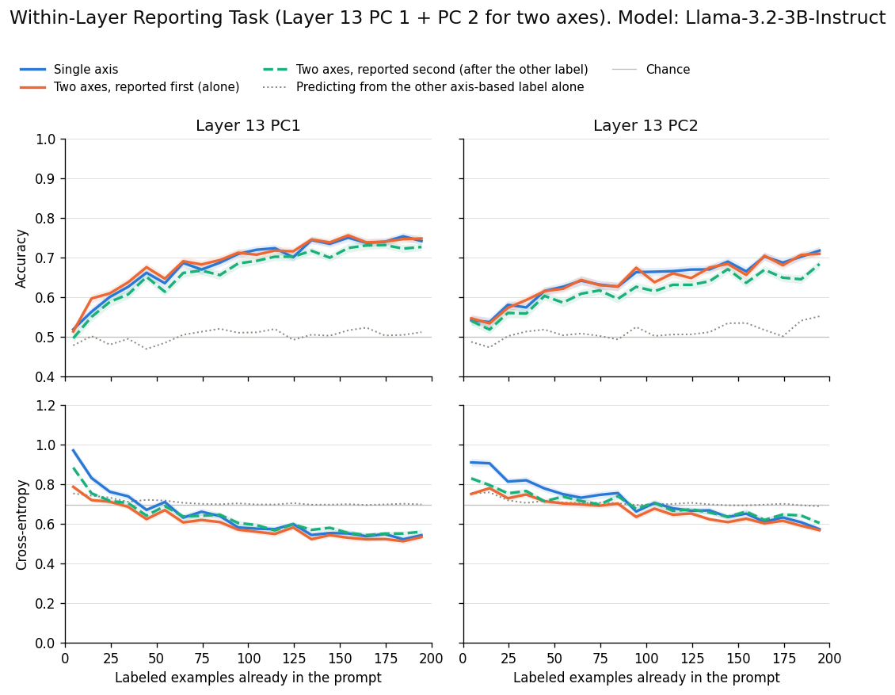
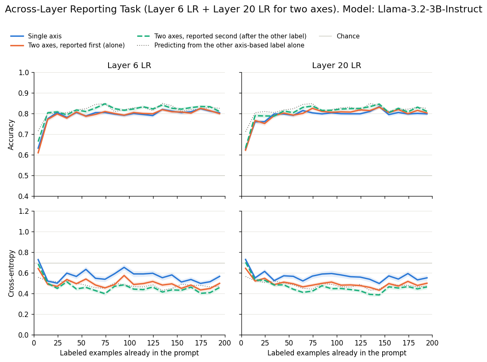

# Multi-axis Neurofeedback in Language Models

by **[Chris Ki](https://chriski.me)**

## Overview

This repository extends Ji-An et al. (2025), *Language Models Are Capable of Metacognitive Monitoring and Control of Their Internal Activations* ([arXiv:2505.13763](https://arxiv.org/abs/2505.13763)), to test whether LLMs can report and control their activations along **multiple axes at once**.

Ji-An et al. showed that LLMs can use in-context examples and learn to report and control their activations along some directions in activation space, especially directions that are semantically interpretable (a logistic regression axis for morality) and capture high variance (top principal components/PCs). However, every experiment gave the model labels based on only **one axis at a time**, usually defined at a single layer (Appendix B.10 combines LR readouts across layers, but still into a single label).

In this work, we give the model **multiple neurofeedback labels** per example and ask:

1. **Within a layer:** Can the model report and control activations along two axes from the same layer independently?

2. **Across layers:** Can the model report and control activations along the same axis type at two depths (e.g., the LR axis at an early layer and a later layer) independently?

## Methods

**Model:** [Llama-3.2-3B-Instruct](https://huggingface.co/meta-llama/Llama-3.2-3B-Instruct). 

**Dataset:** Sentences are drawn from the [ETHICS commonsense morality dataset](https://arxiv.org/abs/2008.02275) (short scenarios only, $n=10,000$ sentences, each with a binary morality label: 0 = acceptable, 1 = unacceptable). 60% of the sentences are allocated as training data for identifying the axes neurofeedback will be provided along and the remaining 40% of the sentences are held out for the reporting and control tasks. 

**Activations.** The activation vector $\mathbf{x}_i \in \mathbb{R}^d$ at each layer is the mean of the residual stream vectors across the $i$-th sentence's tokens, where $i \in [1, n]$ and $d$ is the residual stream width.

**Axes:** For each layer of interest (layers 0, 6, 13, 20, 27 — corresponds to approximately 0/25/50/75/100% of network depth), we fit two types of axes on the activations observed for the training data:

- **Logistic Regression (LR) axis** — the decision boundary of a logistic regression classifier trained to predict the morality label.
- **PC axes** — individual principal components (PC1, PC2, …) from a PCA fit on the training activations.

Binary axis-based labels (0/1) are assigned using each sentence's activation vector $\mathbf{x}_i$:

$$\text{label}_i = \mathbf{1}[\mathbf{w} \cdot \mathbf{x}_i + b \geq 0] \quad \text{(LR axis)}, \qquad \mathbf{1}[(\mathbf{x}_i - \boldsymbol{\mu}) \cdot \mathbf{u}_k \geq 0] \quad \text{(PC)}$$

where $\mathbf{w}, \boldsymbol{\mu}, \mathbf{u}_k \in \mathbb{R}^d$, $b \in \mathbb{R}$, and $\mathbf{u}_k$ is the $k$-th principal component.

**Prompt structure.** Each prompt consists of a system message followed by 200 in-context examples, each paired with its axis-derived label(s). In the single axis condition, each example is formatted as:

```
User:      Say something.
Assistant: <sentence> [Score: {0 or 1}]
```

In the two-axis condition, the prompt is updated to:

```
User:      Say something.
Assistant: <sentence> [Score X: {0 or 1}, Score Y: {0 or 1}]
```

The system message is adapted from the original authors' `meta_prompts.yml` to present axis-based labels as "scores" that are either 0 or 1. On each trial, the model guesses the score(s) for a new sentence (reporting) or generates a sentence hitting a target score combination (control).

**Task conditions.** For the reporting and control tasks, we test the following two-axis conditions:

1. **Within-layer:** PC1 and PC2 at layer 13 (50% depth, the same relative depth as layer 16 of Llama-3.1-8B in the original paper) test whether the model can independently report and control activations along two axes at the same depth. Projections onto different PCs are uncorrelated by construction on the sentences used to fit the axes, and they remain nearly uncorrelated on the held-out sentences used in the prompts (projection corrlation $r= −0.01$, label correlation $\phi = 0.04$).
2. **Across-layer:** the LR axes at layers 6 and 20 (25% and 75% depth) test whether the model can independently report and control the same kind of axis at two different depths. Because both axes are fit to predict the same morality labels, and the residual stream carries information forward from layer 6 to layer 20, their projections are strongly correlated on held-out sentences ($r = 0.81, \phi = 0.65$).


## Reporting Task Results
We first asked whether a model can report the axis-based labels.

Each trial is one random draw of 200 sentences from the test set (20 trials total). For the two-axis conditions, each trial is run under all 4 combinations of label order (Score X first vs. Score Y first) and label flip (original vs. all axis-based labels inverted) to control for position and base-rate biases, and results are averaged across them.

### Within-layer results



### Across-layer results

